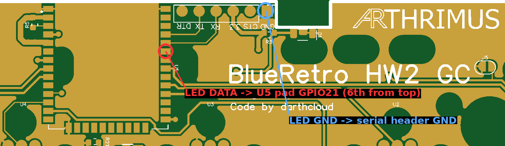

# BlueRetro HW2 QSB for GameCube

## Introdution

This is an internal QSB (Quick Solder Board) for the GameCube Cotroller Port PCB that adds BlueRetro with most of the HW2 Feature set. It is based on [Darthclouds BlueRetro](https://github.com/darthcloud/BlueRetro) and on [ManClouds Current Mirror](https://github.com/ManCloud/CurrentTrigger).

## Features

- **Internal QSB**
  
This PCB is soldered to the GameCube controller port PCB directly, without the need for any wires.

- **Port Detection**
  
  Detects if a controller is physically connected to a controller port and disables BlueRetro for that port. Port detection can be accomplished by 2 different methods.
  - **Current Trigger**
    
    Current Trigger detection requires more components to be installed but does not require as many traces to be cut on the original GameCube controller port PCB

  - **Port Shield**
    
    Port Shield detection requires less components, but requres many traces to be cut on the GameCube controller port PCB.

- **Reset Control**
  
    You can reset the console with the controller and you can change the state of the ESP with the reset button, eg. Pairing mode or resetting the ESP config.
- **Global Status LED**
  
  There is a status LED on the board that can indicate the state of the BlueRetro board. This LED is visible through the GameCube's power led light pipe.

  ## Usage

Please refer to the [BlueRetro Documentation](https://github.com/darthcloud/BlueRetro/wiki) for usage instructions.

## Building the PCB

PCBs should be manufactured at .8mm thickness.

- **Current Trigger Version**
  
  For the Current Trigger version use the [Current Trigger BOM](https://github.com/Arthrimus/BlueRetro-HW2-GameCube/blob/main/PCB/GC%20BlueRetro%20BOM%20(Current%20Trigger).xlsx). Do not close J1-J4
- **Port Shield Version**
  
  For the Port Shield version use the [Port Shield BOM.](https://github.com/Arthrimus/BlueRetro-HW2-GameCube/blob/main/PCB/GC%20BlueRetro%20BOM%20(Port%20Shield).xlsx)
  Close J1-J4. Do not populate Q1,Q11,Q21,Q31,Q2,Q12,Q22,Q32,R1,R11,R21,R31.

## Programming the ESP32

A serial port is provided next to the ESP32. J5 needs to be closed or if the PCB is already installed on the GameCube Controller PCB Reset needs to be held down while connecting the board to your serial progreammer. J5 should be opened once programming is completed.

## Installation

- **Current Trigger Version**
  
Cut 3.3v traces for each controller port as indicated in the image below.

Double check that the 3.3v pins for each controller are no longer connected to the 3.3v traces using a multimeter.

- **Port Shield Version**
  
Cut Shield Ground traces for each controller port as indicated in the image below.

Double check that the shields for each controller are no longer connected to ground using a multimeter.

- **Both Versions**
  
Cut the reset button trace on the front side of the GameCube controller PCB in the location indicated below.

Once all of the traces are cut simply lay the QSB over the pins on the back of the GameCube controller port PCB and solder all of the points on the QSB to the pins and pads that they line up with.

## Optional: Port Status LEDs (WS2812)

Four WS2812B-4020 / WS2812C-4020 addressable LEDs (one per controller port, chained DOUT -> DIN) can show the state of each port. This needs no change to the PCB, only 3 wires.

| LED chain pin | Connect to |
| --- | --- |
| **DIN** (first LED) | ESP32 (U5) pad **GPIO21**. On the side of U5 facing the serial header, it is the **6th pad counting from the U.FL antenna end** (pad 1 is GND, pads 4 and 5 have the traces to the header TX/RX, GPIO21 is the first free pad below them). A 100-330 Ohm series resistor close to the ESP32 is recommended. |
| **GND** | The **GND** pin of the serial header. |
| **VDD** | **5V** (pin 1) of any controller port on the GameCube controller port PCB. Check with a multimeter that it reads ~5V with the console on. Do not use 3.3V, the LEDs need at least ~3.7V. |

GPIO21 is not routed on the PCB and its neighbour pads are NC (unused) and RXD0, so it is the easiest free pad to solder.
GPIO18, GPIO22, GPIO23 and GPIO25 are also supported if you prefer another pad.

The ESP32 outputs 3.3V logic while WS2812 at 5V officially needs >= 3.5V for a high level. Most LEDs work fine anyway, if you see flicker or wrong colors add a diode (1N4148 / 1N5817) in series with the 5V supply of the LEDs to lower their supply to ~4.3V.

### Configuration

The LEDs are disabled by default. Open the **BlueRetro Port LEDs** page of the BlueRetro Web Config, connect, then:

1. Check **Enable port LEDs** and select the data GPIO (GPIO21 by default).
2. Press **Identify chain order**: for 10 seconds the 1st LED of the chain lights red, the 2nd green, the 3rd blue and the 4th yellow. Select for each port the color it showed.
3. Adjust colors and brightness, then press **Save**.

| State | Default |
| --- | --- |
| Wired controller plugged in | White, 50% |
| Bluetooth controller connected | Blue, 50% |
| Pairing (next free port) | Blue breathing, 50% |
| Reset button held (mode selection) | All LEDs amber, solid then flashing 2/4/8 Hz, 50% |

Port LEDs require the BlueRetro firmware with port LED support (N64 and GameCube builds).
